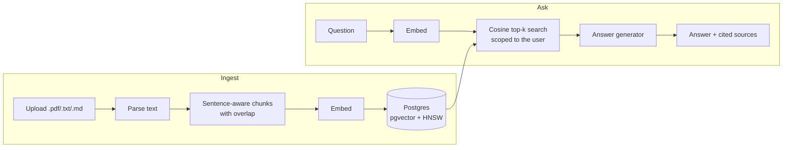

# DocuMind

Upload your own PDFs, Markdown or text files and ask questions about them. Answers are grounded in your documents and cite the passages they came from.

**Stack:** FastAPI · PostgreSQL + pgvector · React (Vite) · Docker Compose · GitHub Actions · pytest

## How it works



1. **Ingest:** text is extracted (`pypdf` for PDFs), split into sentence-aware chunks (~180 words, 40-word overlap so answers that straddle a boundary are still found), embedded, and stored in a `vector(384)` column with an HNSW cosine index.
2. **Retrieve:** the question is embedded and the `top_k` nearest chunks **belonging to the logged-in user** are fetched with pgvector's `<=>` operator.
3. **Generate:** the chunks are given to an answerer as numbered sources.

### Pluggable components (set via env vars)

| Setting | Options | Notes |
|---|---|---|
| `EMBEDDING_PROVIDER` | `hashing` (default), `sbert` | `hashing` is offline, deterministic, lexical. `sbert` (all-MiniLM-L6-v2, `pip install sentence-transformers`) gives real semantic search. Both are 384-dim. |
| `LLM_PROVIDER` | `extractive` (default), `anthropic` | `extractive` needs no API key and returns the most relevant sentences with `[n]` citations. `anthropic` calls the Messages API with a prompt that restricts answers to the retrieved sources and treats them as untrusted data. |

Changing the embedding model/dimension after documents are indexed requires re-indexing.

## Run it

```bash
cp .env.example .env          # set JWT_SECRET to a long random string
docker compose up --build
```

- App: http://localhost:8080
- API docs: http://localhost:8000/docs

To use an LLM for answers, set `LLM_PROVIDER=anthropic` and `ANTHROPIC_API_KEY` in `.env`.

### Local development

```bash
# database
docker run -d -p 5432:5432 -e POSTGRES_USER=documind -e POSTGRES_PASSWORD=documind \
  -e POSTGRES_DB=documind pgvector/pgvector:pg16

# backend
cd backend && python -m venv .venv && source .venv/bin/activate
pip install -r requirements-dev.txt
uvicorn app.main:create_app --factory --reload

# frontend (proxies /api to :8000)
cd frontend && npm install && npm run dev
```

## API

| Method | Path | Description |
|---|---|---|
| POST | `/auth/register`, `/auth/login` | Returns a JWT bearer token |
| POST | `/documents` | Upload a file (`multipart/form-data`, field `file`) |
| GET | `/documents` | List your documents |
| DELETE | `/documents/{id}` | Delete a document and its chunks |
| POST | `/query` | `{"question": "...", "top_k": 4}` → `{answer, sources[]}` |
| GET | `/health` | Liveness check |

## Tests

```bash
cd backend
pytest                                   # unit + API tests (in-memory store)
TEST_DATABASE_URL=postgresql+psycopg://postgres:pw@localhost:5432/postgres pytest   # + pgvector integration tests
ruff check .
```

CI (GitHub Actions) runs lint, all tests including the pgvector integration tests against a `pgvector/pgvector:pg16` service container, the frontend build, and both Docker image builds.

## Design decisions

- **Repository interface** (`Repository` protocol) with Postgres and in-memory implementations, so the API and RAG logic are tested without a database while the SQL is tested against real pgvector in CI.
- **Per-user isolation** is enforced in the query itself (`WHERE user_id = ...`), and covered by tests for search, listing and delete.
- **Passwords** are SHA-256 pre-hashed then bcrypt'd, which avoids bcrypt's 72-byte truncation.
- **Uploads** are size-limited, extension-checked, and NUL bytes are stripped (Postgres rejects them in `text`).
- **Prompt injection:** retrieved text is wrapped in `<source>` tags and the system prompt tells the model to treat it as data, not instructions. This reduces the risk but is not a guarantee.

## Known limitations / next steps

- Default `hashing` embedder is lexical, so paraphrased questions can miss; switch to `sbert` for semantic matching.
- Schema is created on startup (`create_all`); a migration tool such as Alembic would be the next step.
- Scanned PDFs (images with no text layer) are rejected; OCR is not implemented.
- No rate limiting, token refresh, or streaming responses yet.
- The JWT is kept in `localStorage`, which is simple but exposed to XSS; httpOnly cookies would be stronger.
